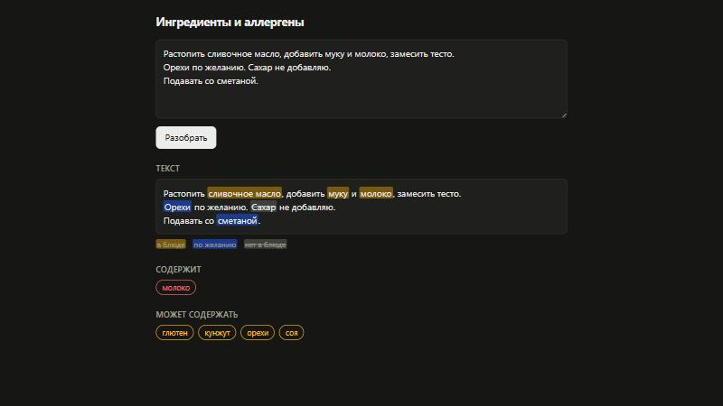

# ingredient-ner

Извлечение ингредиентов и аллергенов из русских текстов рецептов.



## Подход

1. Названия из справочника ингредиентов ищутся в тексте по леммам (pymorphy3)
   и словоформам.
2. Находки, подтверждённые составом рецепта, — разметка для обучения NER
   (14 695 рецептов).
3. `cointegrated/rubert-tiny2` дообучается на этой разметке.
4. Статус упоминания (есть в блюде / по желанию / нет) определяется правилами
   по контексту в духе NegEx/ConText.
5. Упоминание связывается со справочником; аллергены — по перечню
   ТР ТС 022/2011.

## Результаты

Test: 100 рецептов с ручной разметкой, 1749 упоминаний. Модель выбрана на dev
(90 рецептов).

Упоминания ингредиентов, точное совпадение границ:

| Система | P | R | F1 |
|---|---|---|---|
| словарь | 0.652 | 0.915 | 0.762 |
| словарь + фильтр по составу | 0.930 | 0.823 | 0.873 |
| модель | 0.894 | 0.871 | **0.882** |

Аллергены блюда, пары «блюдо, аллерген», F2:

| Система | P | R | F2 |
|---|---|---|---|
| словарь | 0.482 | 0.993 | 0.819 |
| словарь + фильтр по составу | 0.568 | 0.926 | 0.822 |
| модель | 0.571 | 0.968 | **0.850** |

Разность с моделью: 95% интервал — парный бутстреп по рецептам, p —
перестановочный тест.

| Сравнение | Δ | 95% интервал | p |
|---|---|---|---|
| F1: модель − словарь | +0.121 | [+0.098, +0.142] | < 0.001 |
| F1: модель − словарь + фильтр | +0.009 | [−0.013, +0.027] | 0.42 |
| F2: модель − словарь | +0.031 | [+0.008, +0.052] | 0.004 |
| F2: модель − словарь + фильтр | +0.028 | [+0.001, +0.058] | 0.067 |

## Данные

- Составы рецептов — [rogozinushka/povarenok-recipes](https://huggingface.co/datasets/rogozinushka/povarenok-recipes).
- Тексты — povarenok.ru, 14 885 рецептов; в репозиторий не входят.
- Ручная разметка — 100 рецептов test и 90 dev; [правила](docs/annotation.md).

## Запуск

```
pip install -e .[dev]
pytest
```

Конвейер в `scripts/`: `prepare_recipes` → `crawl` → `assemble_texts` →
`build_canon` → `build_ner_data` → `train` → `evaluate`, `evaluate_allergens`.
Данные — в `data/` или в каталоге из `INGREDIENT_NER_DATA`.

Веса модели не включены (116 МБ):

```
python scripts/train.py --variant B --seed 42
python scripts/demo.py
```

`demo.py` открывает страницу разбора текста на `http://127.0.0.1:8000`.
